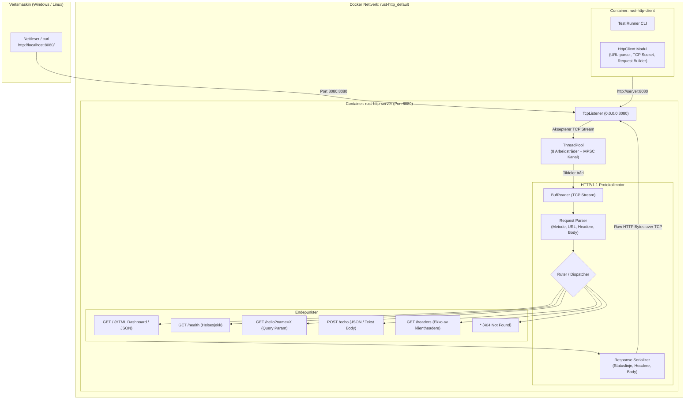
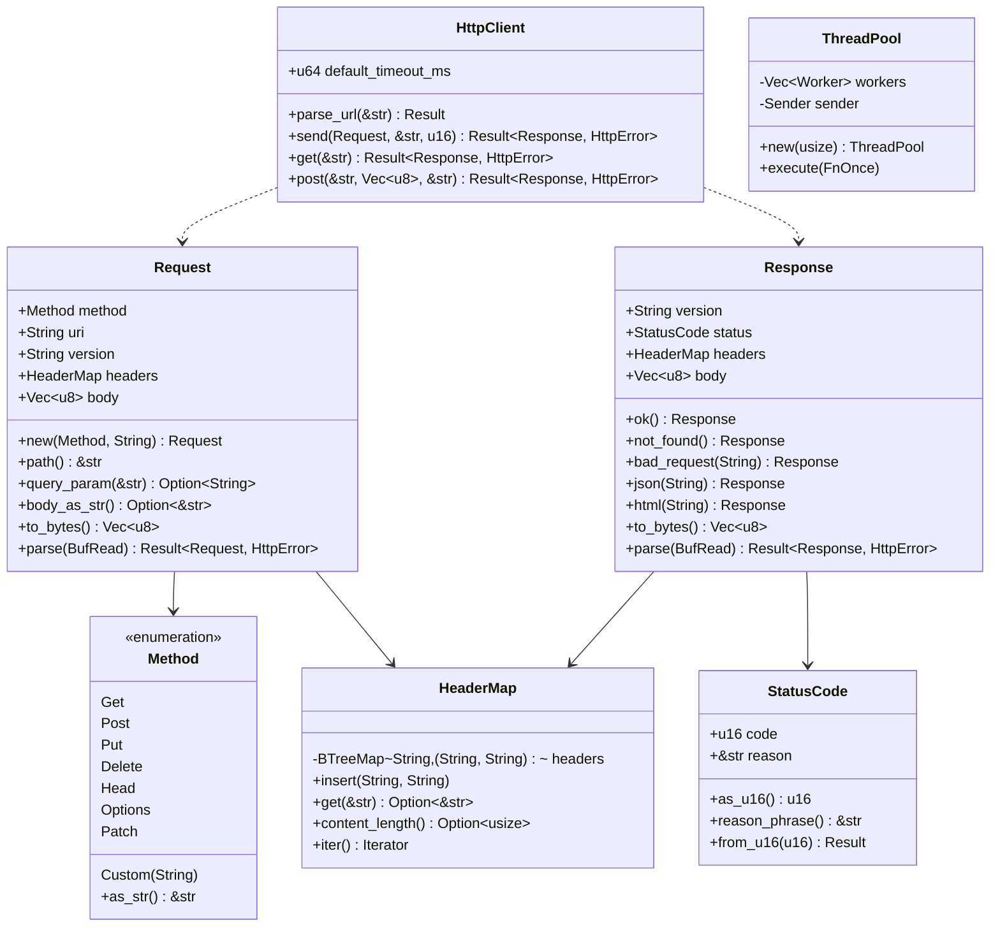
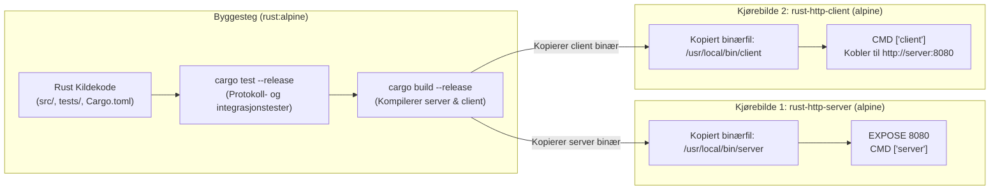

# 🦀 Rust Custom HTTP/1.1 Protokoll (Server & Klient med Docker)

En ren, produksjonsklar og grundig implementasjon av **HTTP/1.1-protokollen (RFC 7230)** fra bunnen av i **Rust**, helt uten eksterne web-rammeverk som Actix, Hyper eller Reqwest. Prosjektet inneholder både en **flertrådet HTTP-server**, en **HTTP-klient** og en **Docker / Docker Compose**-arkitektur med helsesjekk.

Repository: [https://github.com/roblar658/http-server-rust](https://github.com/roblar658/http-server-rust)

---

## 🏛️ System- og Nettverksarkitektur

Følgende diagram viser hvordan klient, server, nettleser og Docker-nettverket samhandler:



---

## 🔄 Protokoll-Livssyklus (Sekvensdiagram)

Dette diagrammet illustrerer nøyaktig hva som sendes over rå TCP-sockets når en HTTP-forespørsel utføres og besvares:

```mermaid
sequenceDiagram
    autonumber
    participant Client as 🚀 HTTP-Klient / Nettleser
    participant Socket as 🔌 TCP Socket (Port 8080)
    participant Worker as 🧵 Server Arbeidstråd
    participant Engine as ⚙️ Protokollmotor & Ruter

    Client->>Socket: TCP 3-veis håndtrykk (SYN -> SYN-ACK -> ACK)
    Client->>Socket: Sender rå HTTP/1.1-forespørsel bytes:\nPOST /echo HTTP/1.1\r\nHost: server:8080\r\nContent-Type: application/json\r\nContent-Length: 32\r\nConnection: close\r\n\r\n{"melding":"Hei fra klienten!"}

    Socket->>Worker: Tildeler aktiv TcpStream fra ThreadPool
    Worker->>Engine: Request::parse(&mut BufReader)
    Note over Engine: Leser requestlinje, parser headere til HeaderMap,<br/>leser nøyaktig Content-Length bytes med body
    Engine->>Engine: Ruter matcher "POST /echo"
    Engine->>Worker: Genererer Response::ok().json(...)

    Worker->>Socket: Sender rå HTTP/1.1-svar bytes:\nHTTP/1.1 200 OK\r\nServer: RustCustomHttp/1.0\r\nContent-Type: application/json; charset=utf-8\r\nContent-Length: 78\r\nConnection: close\r\n\r\n{"echoed_body":{...},"length":32}

    Socket->>Client: Mottar HTTP-svar over nettverket
    Client->>Client: Response::parse(&mut BufReader)
    Socket-->>Client: Lukker TCP-tilkobling (Connection: close)
```

---

## 🧩 Datamodell & Modulstruktur



---

## 📦 Docker Bygge- og Kjøringspipeline



---

## 📂 Fil- og Mappestruktur

```text
C:\dev\rust-http\
├── Cargo.toml                  # Prosjektkonfigurasjon (server + client binærer)
├── Dockerfile                  # Multi-stage Dockerfile med testkjøring og minimale Alpine-bilder
├── docker-compose.yml          # Orkestrering med helsesjekk og automatisk klienttest
├── run.ps1                     # PowerShell-snarvei for bygging og oppstart
├── README.md                   # Arkitektur- og brukerveiledning
├── src/
│   ├── lib.rs                  # Felles kjernebibliotek og enhetstester
│   ├── error.rs                # Egendefinert HttpError feilhåndtering
│   ├── method.rs               # HTTP-metoder (GET, POST, PUT, DELETE, etc.)
│   ├── status.rs               # HTTP statuskoder (200 OK, 404, 500, etc.)
│   ├── headers.rs              # Case-insensitiv HeaderMap (RFC 7230)
│   ├── request.rs              # Request-parser med query-parametre og body
│   ├── response.rs             # Response-parser og byte-serialisering
│   ├── threadpool.rs           # Trådpool for flertrådet TCP-server
│   ├── client.rs               # HttpClient for sending av HTTP-forespørsler
│   └── bin/
│       ├── server.rs           # HTTP-server som lytter på 0.0.0.0:8080 med HTML UI og ruter
│       └── client.rs           # HTTP-klient CLI med automatisert testsuite
└── tests/
    └── protocol_tests.rs       # Integrasjonstester (norske tegn, URL-parsing, m.m.)
```

---

## 🚀 Kjøring

### 1. Start med Docker (Anbefalt)

```powershell
cd C:\dev\rust-http
.\run.ps1
```

Eller direkte via Docker:

```powershell
# Start serveren i bakgrunnen
docker compose up -d server

# Kjør klienttesten
docker compose run --rm client

# Stopp serveren når ferdig
docker compose down
```

---

## 🌐 Test i nettleser eller med curl

Når serveren kjører i Docker, åpne:
- **Dashboard & Tester:** [http://localhost:8080/](http://localhost:8080/)
- **Helsestatus:** [http://localhost:8080/health](http://localhost:8080/health)
- **Query-parameter:** [http://localhost:8080/hello?name=Verden](http://localhost:8080/hello?name=Verden)
- **Ekko med curl:**
  ```powershell
  curl -X POST http://localhost:8080/echo -H "Content-Type: application/json" -d '{"melding":"hei!"}'
  ```

---

## 💻 Kjøring lokalt med Cargo

Dersom Rust er installert lokalt på maskinen:

```powershell
# Kjøre alle tester
cargo test

# Starte serveren
cargo run --bin server

# Kjøre klienten (i et annet terminalvindu)
cargo run --bin client
```
